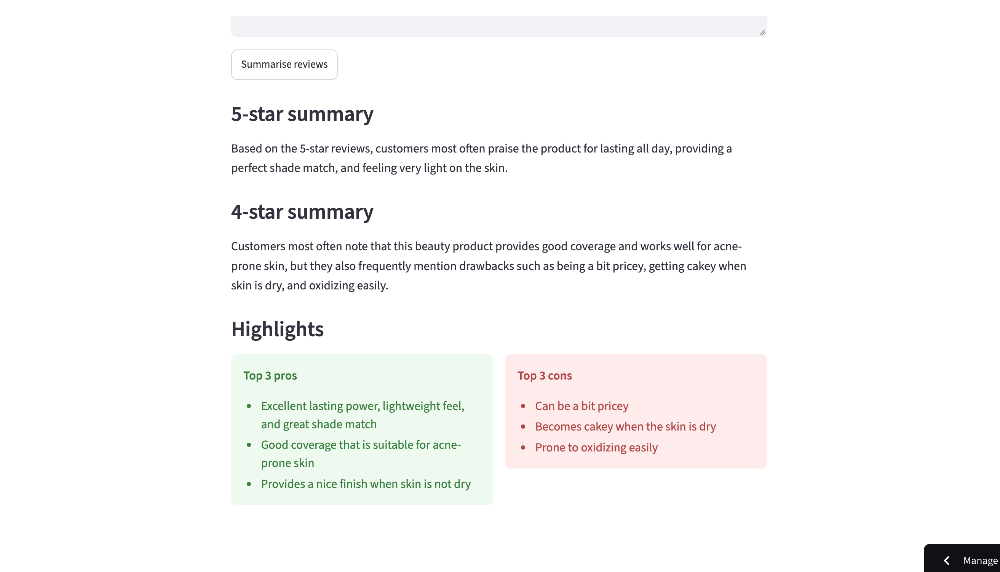

# Nykaa Review Summariser

A small web app that turns pasted customer reviews into quick insights.

**Live app:** (https://nykaa-review-summariser-bbrxsbakbktntz2zoie3bq.streamlit.app/)

## What it does
- Takes 5-star and 4-star product reviews pasted from Nykaa
- Writes a short summary paragraph for each rating group
- Lists the top 3 pros and top 3 cons based on the reviews

## How it works
1. Reviews are pasted in and sorted by star rating
2. Each group is sent to the Gemini AI model with a prompt asking for a summary
3. A second prompt asks for the top pros and cons, which are shown in two columns

## Built with
Python, Streamlit, Google Gemini API

## What I learned
- Writing prompts that return output in a predictable format
- Handling API errors by retrying when the model is busy
- Keeping API keys secret instead of putting them in the code

## Limitations and next steps
- Reviews are pasted in manually, not fetched automatically
- Next: add 3-star reviews, and try different prompts to compare summary quality
