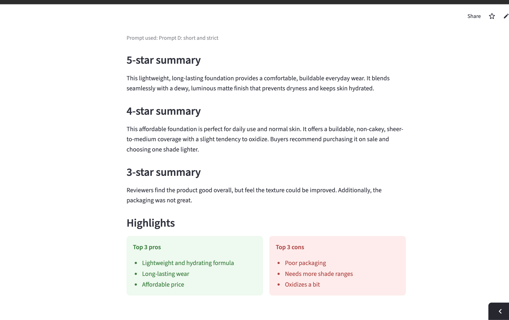

# Nykaa Review Summariser

A small web app that turns pasted customer reviews into quick insights.

**Live app:** (https://nykaa-review-summariser-bbrxsbakbktntz2zoie3bq.streamlit.app/)

<table align="center">
  <tr>
    <td align="center">
       
      <b>Image 1: Tested on a basic simple prompt with 5 and 4 star reviews. </b>
    </td>
    <td align="center">
       
      <b>Image 2: Picked a specific prompt to get sharp results. Also added 3 star reviews.</b>
    </td>
  </tr>
</table>

## What it does
- Takes 5-star, 4-star and 3-star product reviews pasted from Nykaa
- Writes a short summary paragraph for each rating group
- Lists the top 3 pros and top 3 cons based on the reviews

## How it works
1. Reviews are pasted in and sorted by star rating
2. Each group is sent to the Gemini AI model with a prompt asking for a summary
3. A second prompt asks for the top pros and cons, which are shown in two columns

## Built with
Python, Streamlit, Google Gemini API

## What I learned
- Writing prompts that return output in a predictable format
- Handling API errors by retrying when the model is busy
- Keeping API keys secret instead of putting them in the code

## Limitations and next steps
- Reviews are pasted in manually, not fetched automatically
- Tested on a small number of products, so results may vary on others
- Next: try a different AI model and compare summary quality

## Prompt experiment

I tested 4 different prompts on the same 10 reviews (5 five-star, 5 four-star) of one foundation, and scored each from 1 to 5 on four questions: Accurate, Complete, Useful, Concise.

| Prompt | Accurate | Complete | Useful | Concise | Total |
|---|---|---|---|---|---|
| A: simple | 4 | 4 | 4 | 3 | 15 |
| B: structured | 3 | 4 | 4 | 2 | 13 |
| C: shopper-focused | 4 | 4 | 4 | 1 | 13 |
| D: short and strict | 4 | 4 | 5 | 4 | 17 |

**What I found**
- Prompts B and C were accurate but long and repetitive, up to 253 words in total. A shopper should not need a minute to read a summary.
- Prompt B contradicted itself: its summary said the foundation does not oxidise, while its cons said it does. I fixed this by telling the AI to follow the majority view when reviews disagree.
- Prompt C kept saying "real buyers", which added nothing, so I removed the phrase.
- A 50-word limit risked cutting out important points, so I raised it to 50 words. Prompt D then wrote 78 words in total and scored best.

**What I'd improve next**
- Stop the AI saying "many reviewers" when only one said it
- Test on more products and more reviews
- Take the review as many "only say ‘many’ if three or more reviews agree"
